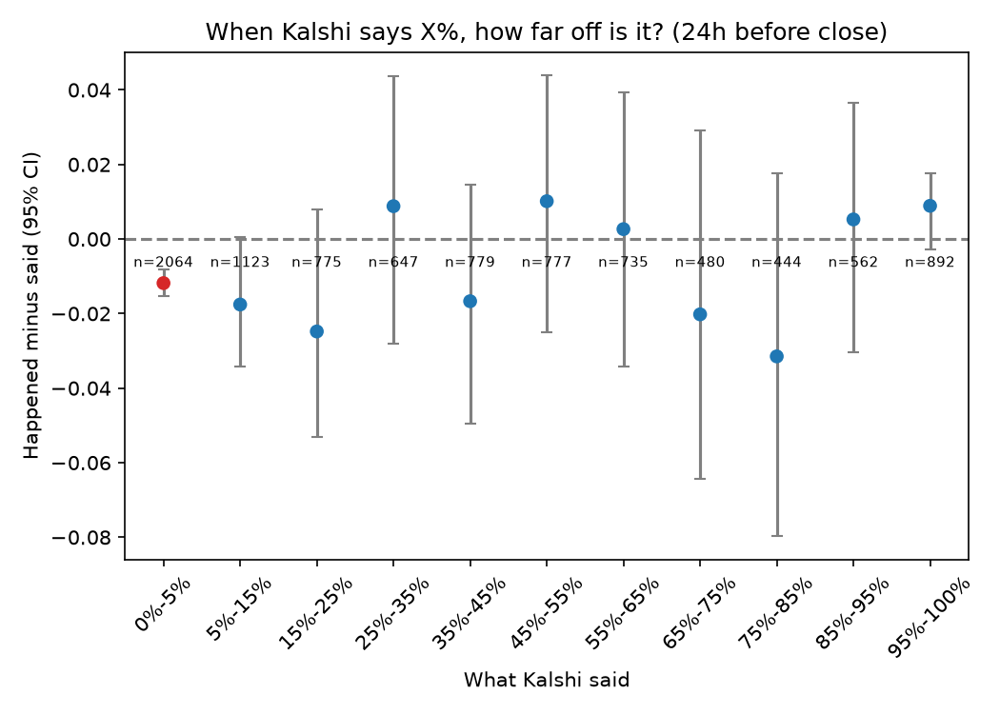

# Kalshi Calibration Lab

**Is Kalshi lying? When a market says 70%, does it happen 70% of the time?**

A small, from-scratch study of prediction-market prices. It measures how far prices are from the frequencies they imply, slices that by price level, time horizon and category (sports, weather, elections, economics and more), then tests whether simple recalibration models beat the raw price. 

## The short answer

**Mostly no, with one small exception at the extremes.** Across 22,019 price observations from 3,695 settled events (ten weeks of data, 31 Aug to 7 Nov 2026), when Kalshi says 70% the thing happens about 70% of the time.

| Kalshi said (24h before close) | Happened | n events | Verdict |
|---|---|---|---|
| 65-75% (all categories) | 67.3% (said 69.3%) | 371 | Consistent: gap -2.0 pts, 95% interval -6.4 to +2.9 |
| 45-55% | 50.5% (said 49.4%) | 724 | Consistent |
| 85-95% | 90.6% (said 90.0%) | 305 | Consistent |
| 0-5% | **0.7% (said 1.9%)** | 960 | **Longshots happen less often than priced** (significant after Benjamini-Hochberg false-discovery control) |
| 95-100% | 98.8% (said 97.9%) | 436 | Slightly under-confident, not significant at 24h; significant at 1h |

The exception is the classic favorite-longshot pattern: very cheap contracts win about 1 to 2 points less often than their price, and near-certain ones win about 1 point more often. It is small, it shows up in non-sports markets (sports has few extreme prices; two extreme sports bands are flagged at 1h and 168h, in the same direction), and part of it is the 1 cent minimum price: a contract that is really 0.5% likely still cannot trade below 1 cent. Treat it as "prices are rounded toward the middle at the extremes", not as Kalshi misleading anyone.

## Other results

- **Recalibration does not help.** On a time-ordered test set (all categories), the raw market scored Brier 0.1080 at 24h against 0.1083 (Platt) and 0.1082 (isotonic); 0.0437 vs 0.0436 and 0.0439 at 1h; 0.0953 vs 0.0954 and 0.0979 at 168h. These are ties. The only visible gain is log loss at 1h (0.1455 to 0.1388 with Platt), which is where mispriced tails cost the most. No confidence intervals on these test scores yet.
- **Volume does not explain error.** An earlier version of this README reported that busier markets had *larger* errors (the opposite of Kalshi's paper). That was lookahead: it used each market's final volume, which includes trading after the prediction time. Using volume traded *before* the horizon, the partial correlation with error (controlling for how close to 50/50 the price is) falls from +0.03 to +0.13 (depending on horizon) to between -0.04 and +0.02. There is no volume effect left to explain.
- **The 1h horizon is not forecasting for most non-sports markets.** A daily high temperature is effectively known hours before the market closes (weather Brier at 1h is about 0.000). Use 24h and 168h to judge pricing; 1h measures how fast prices converge.
- **Horizons differ in population.** 168h only exists for markets that opened a week out, so it is a smaller, different set, not a trend.

| Finding | Paper | Ours | Verdict |
|---|---|---|---|
| Tail truncation (2-98c) raises Brier | yes | 0.166 vs 0.134 at 1h | Consistent |
| Event-time anchor changes Sports Brier | improves | 0.134 -> 0.113 at 1h | Consistent in direction (cause not investigated) |
| Sports Brier / accuracy levels | 0.104-0.155 / 76-86% | 0.134-0.187 / 69-80% | Not comparable: the paper pools all sports markets including near-certain props; we use near-coin-flip game winners |
| More volume, lower error | yes | rho -0.11 at 24h (consistent), +0.14 at 1h (not), none after controlling for closeness | Inconclusive |

## Limitations

- Ten weeks of settled markets (31 Aug to 7 Nov 2026), 69 distinct close dates. Older markets sit behind Kalshi's historical endpoints and are not included. Sports is 2,588 events; most other categories are too small to judge alone.
- Election results come mostly from one night, so they carry far fewer independent observations than their event count suggests.
- The 1 cent minimum price compresses the lowest prices; 21% of 24h non-sports prices are at or below 2 cents.
- Model comparisons have no confidence intervals on the test-set scores, and the test set is time-ordered, so it reflects one period.
- The 168h horizon only exists for markets that opened a week out, so it is a different (and smaller) population.
- Candle prices are last traded prices, which can be stale on thin markets.
- This describes how prices behaved; it says nothing about whether any strategy would have made money.

## License

MIT. See [LICENSE](LICENSE).
